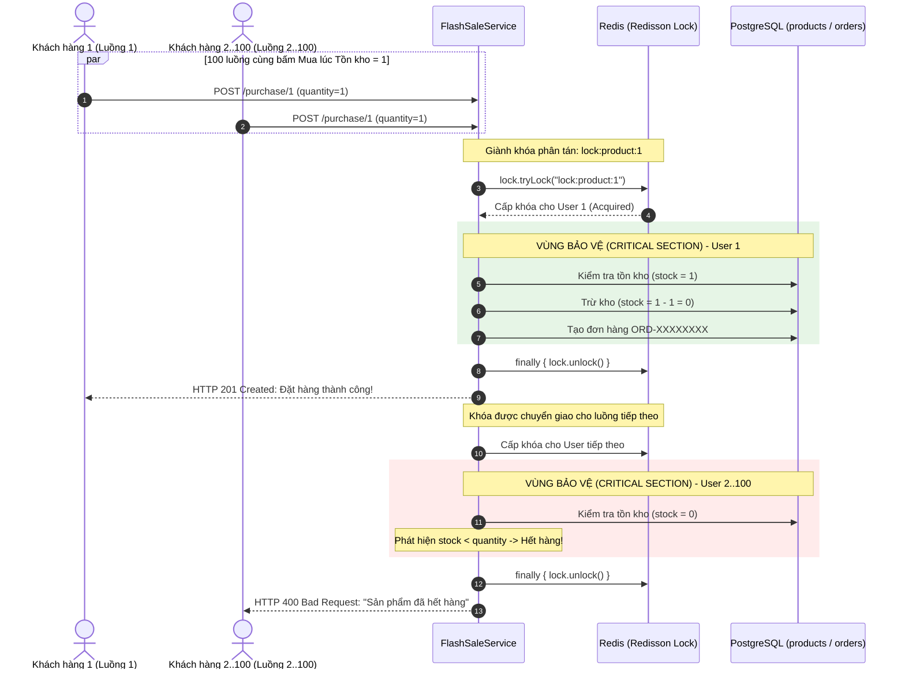

# [Bài tập 3] Chống "bán lố" (Overselling) bằng Redis Distributed Lock

Dự án triển khai giải pháp chống "bán lố" (Overselling) trong các đợt **Flash Sale** chịu tải cao bằng cách sử dụng **Redisson Distributed Lock** trên nền tảng **Spring Boot**, **PostgreSQL** và **Redis**.

---

## 1. Bối cảnh & Mục tiêu bài toán

* **Bối cảnh**: Trong các sự kiện Flash Sale (ví dụ: mở bán sản phẩm giới hạn 1 chiếc với giá 1k), hàng trăm, hàng nghìn người dùng cùng nhấn nút "Đặt mua" tại cùng một tích tắc (mili-giây).
* **Vấn đề (Race Condition - Concurrency Issue)**:
  * Nếu hệ thống kiểm tra tồn kho đồng thời mà không có cơ chế khóa (locking), tất cả các luồng (threads) đều đọc được `stockQuantity = 1` $\rightarrow$ Tất cả đều trừ tồn kho và tạo đơn thành công $\rightarrow$ Xảy ra hiện tượng **"bán lố" (Overselling)**, kho bị âm và doanh nghiệp thiệt hại nặng.
* **Giải pháp với Redisson Distributed Lock**:
  * Mỗi khi có yêu cầu mua sản phẩm `{id}`, Service phải giành được khóa phân tán tương ứng: `lock:product:{id}`.
  * Chỉ luồng giành được khóa mới được phép vào vùng tương tranh (critical section) để kiểm tra tồn kho và trừ số lượng.
  * Các luồng khác phải xếp hàng chờ. Khi luồng đầu tiên trừ hết hàng (`stock = 0`), các luồng tiếp theo vào kiểm tra sẽ ngay lập tức nhận thông báo **"Sản phẩm đã hết hàng"**.
  * Bắt buộc giải phóng khóa (`lock.unlock()`) trong khối `finally` để tránh deadlock/treo hệ thống.

---

## 2. Kiến trúc & Sơ đồ luồng xử lý



---

## 3. Cấu trúc mã nguồn

```text
MD_04_Buoi12_Kha1/
│── docker-compose.yml          # Dịch vụ PostgreSQL (flashsale_db) & Redis (port 6379)
│── README.md                   # Tài liệu hướng dẫn & Báo cáo kết quả kiểm thử
└── product-service/
    ├── build.gradle            # Dependencies: Redisson, JPA, Web, PostgreSQL, Test
    └── src/
        ├── main/
        │   ├── java/com/example/productservice/
        │   │   ├── config/
        │   │   │   ├── RedissonConfig.java       # Cấu hình RedissonClient
        │   │   │   └── DataInitializer.java     # Khởi tạo sẵn 1 sản phẩm mẫu Flash Sale (stock=1)
        │   │   ├── controller/
        │   │   │   └── FlashSaleController.java  # REST API: purchase, reset-stock, view orders
        │   │   ├── dto/
        │   │   │   ├── PurchaseRequest.java
        │   │   │   └── PurchaseResponse.java
        │   │   ├── entity/
        │   │   │   ├── Product.java              # Entity sản phẩm (id, name, stockQuantity, price)
        │   │   │   └── Order.java                # Entity đơn hàng
        │   │   ├── repository/
        │   │   │   ├── ProductRepository.java
        │   │   │   └── OrderRepository.java
        │   │   └── service/
        │   │       └── FlashSaleService.java     # Logic giành Redisson Lock & trừ kho an toàn
        │   └── resources/
        │       └── application.yaml              # Cấu hình DB PostgreSQL & Redis
        └── test/
            └── java/com/example/productservice/
                └── FlashSaleConcurrencyTest.java # Test đa luồng: 100 luồng đồng thời mua 1 sản phẩm
```

---

## 4. Hướng dẫn khởi chạy

### Bước 1: Khởi động Redis & PostgreSQL với Docker Desktop
Tại thư mục gốc dự án:
```bash
docker compose up -d
```
* **Redis**: `localhost:6379`
* **PostgreSQL**: `localhost:5432` (Database: `flashsale_db`, User: `postgres`, Password: `123456`)

### Bước 2: Chạy ứng dụng Spring Boot
Di chuyển vào thư mục `product-service`:
```bash
cd product-service
./gradlew bootRun
```
*Ứng dụng sẽ tự động tạo bảng `products`, `orders` và khởi tạo sẵn 1 sản phẩm mẫu ID = 1 (Tồn kho = 1).*

---

## 5. Kết quả kiểm thử đa luồng (Concurrency Test)

Dự án tích hợp sẵn test case đa luồng `FlashSaleConcurrencyTest.java` sử dụng `ExecutorService(100)` và `CountDownLatch(100)` để mô phỏng 100 người dùng bấm mua đồng thời:

```bash
cd product-service
./gradlew test
```

### Kết quả chạy thực tế:
```text
==================================================================
 KẾT QUẢ KIỂM THỬ ĐA LUỒNG FLASH SALE VỚI REDISSON LOCK:
 - Tổng số luồng yêu cầu mua đồng thời: 100
 - Số đơn mua thành công             : 1
 - Số yêu cầu nhận 'Hết hàng'        : 99
 - Lỗi khác                          : 0
 - Thời gian xử lý 100 yêu cầu       : 1174 ms
==================================================================
FlashSaleConcurrencyTest > Kiểm thử 100 người cùng bấm mua sản phẩm có tồn kho = 1: Không được bán lố (Overselling) PASSED

BUILD SUCCESSFUL
```
* **Tồn kho cuối cùng trong DB**: `0` (Tuyệt đối không bị âm).
* **Số đơn hàng được tạo trong bảng orders**: Đúng duy nhất `1` đơn hàng.

---

## 6. Kiểm thử API bằng cURL

### 6.1. Xem sản phẩm và tồn kho ban đầu (ID = 1)
```bash
curl -X GET http://localhost:8080/api/v1/flashsale/products/1
```
*Output*:
```json
{
  "id": 1,
  "name": "iPhone 16 Pro Max 256GB - Flash Sale 1k",
  "stockQuantity": 1,
  "price": 1000.00
}
```

### 6.2. Người thứ nhất đặt mua (Thành công)
```bash
curl -X POST http://localhost:8080/api/v1/flashsale/purchase/1 \
  -H "Content-Type: application/json" \
  -d '{
    "userId": "user_001",
    "quantity": 1
  }'
```
*Phản hồi (HTTP 201 Created)*:
```json
{
  "success": true,
  "message": "Đặt hàng thành công!",
  "remainingStock": 0,
  "orderId": "ORD-E3F4A5B6"
}
```

### 6.3. Người thứ hai đặt mua (Hết hàng)
```bash
curl -X POST http://localhost:8080/api/v1/flashsale/purchase/1 \
  -H "Content-Type: application/json" \
  -d '{
    "userId": "user_002",
    "quantity": 1
  }'
```
*Phản hồi (HTTP 400 Bad Request)*:
```json
{
  "success": false,
  "message": "Sản phẩm đã hết hàng",
  "remainingStock": 0,
  "orderId": null
}
```

### 6.4. Reset lại tồn kho để kiểm thử tiếp
```bash
curl -X POST "http://localhost:8080/api/v1/flashsale/products/1/reset-stock?stock=1"
```
