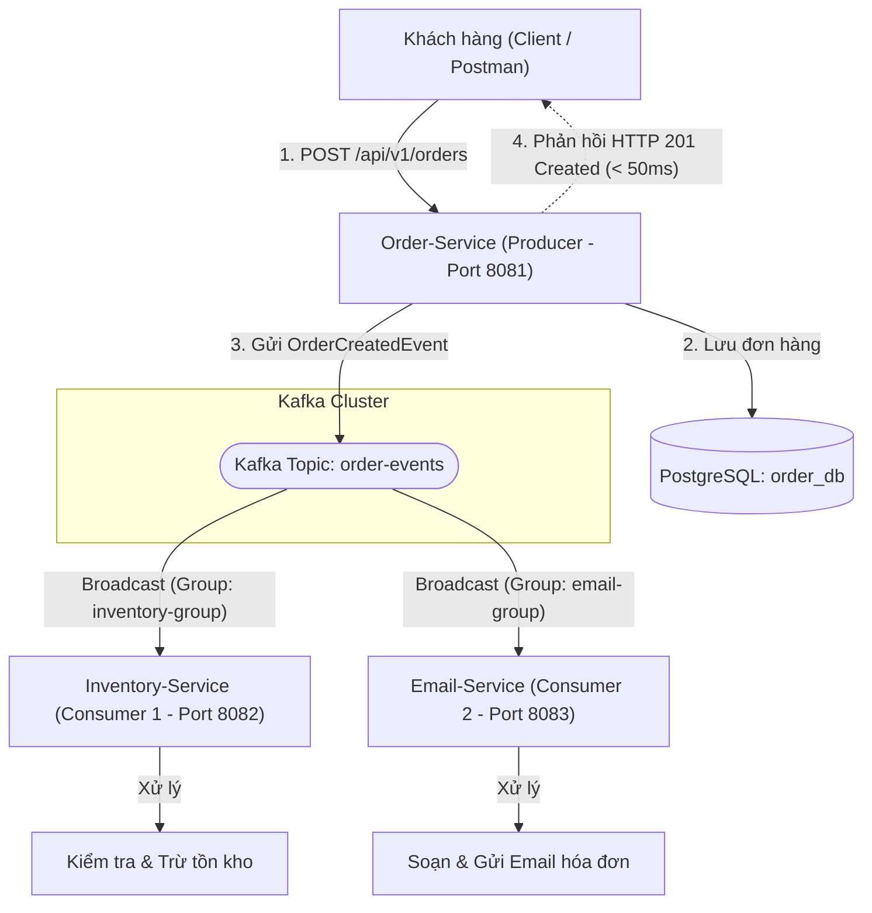

# [Bài tập] Xử lý đơn hàng bất đồng bộ với Apache Kafka

Dự án triển khai theo kiến trúc **Event-Driven Microservices Architecture** sử dụng **Spring Boot**, **JDK 17**, **PostgreSQL** và **Apache Kafka** (chạy trên **Docker Desktop** với chế độ KRaft).

---

## 1. Mục tiêu & Bối cảnh bài toán

* **Bối cảnh**: Khi khách hàng bấm "Đặt hàng", hệ thống cần thực hiện nhiều tác vụ phụ trợ: trừ kho, gửi email thông báo/hóa đơn, tích điểm thành viên, v.v. Nếu xử lý đồng bộ (synchronous), khách hàng sẽ phải chờ rất lâu (hàng giây), dễ gây nghẽn kết nối và giảm trải nghiệm người dùng.
* **Giải pháp bất đồng bộ (Asynchronous with Kafka)**:
  * **Order-Service (Producer - Port 8081)**: Tiếp nhận yêu cầu, lưu đơn hàng vào DB với trạng thái `CREATED`, đóng gói và gửi sự kiện `OrderCreatedEvent` vào Kafka Topic `order-events`, sau đó **ngay lập tức phản hồi thành công** cho khách hàng ($\le 20-50\text{ms}$).
  * **Inventory-Service (Consumer 1 - Port 8082)**: Lắng nghe topic `order-events` với `group-id: inventory-group` để tiến hành kiểm tra và trừ số lượng hàng tồn kho.
  * **Email-Service (Consumer 2 - Port 8083)**: Lắng nghe topic `order-events` với `group-id: email-group` để soạn thảo và gửi email hóa đơn xác nhận đơn hàng cho khách hàng.

---

## 2. Sơ đồ kiến trúc & Luồng xử lý (Fan-out Pattern)



### 💡 Tại sao phải dùng **khác `group-id`**?
* **Mô hình Queue (Cùng group-id)**: Nếu 2 service dùng chung `group-id`, Kafka chỉ phân phối message cho 1 trong 2 service (Competing Consumers) $\rightarrow$ Hoặc chỉ trừ kho mà không gửi mail, hoặc chỉ gửi mail mà không trừ kho.
* **Mô hình Pub/Sub Fan-out (Khác group-id)**: Khi `Inventory-Service` dùng `inventory-group` và `Email-Service` dùng `email-group`, mỗi Consumer Group duy trì offset riêng $\rightarrow$ Cả hai service đều nhận được một bản sao sự kiện `OrderCreatedEvent` để xử lý độc lập và song song.

---

## 3. Cấu trúc thư mục dự án

```text
MD_04_Buoi12_Kha1/
│── docker-compose.yml          # Hạ tầng Kafka Broker (KRaft) & PostgreSQL
│── README.md                   # Tài liệu hướng dẫn chi tiết
│── order-service/              # Spring Boot Producer (Port 8081)
│   ├── build.gradle
│   └── src/main/java/com/example/orderservice/
│       ├── config/             # KafkaTopicConfig (tự động tạo topic)
│       ├── controller/         # OrderController (tiếp nhận đặt hàng)
│       ├── dto/                # OrderCreatedEvent, CreateOrderRequest
│       ├── entity/             # Order Entity
│       ├── producer/           # OrderProducerService (gửi Kafka)
│       └── repository/         # OrderRepository
│── inventory-service/          # Spring Boot Consumer 1 (Port 8082, group: inventory-group)
│   ├── build.gradle
│   └── src/main/java/com/example/inventoryservice/
│       ├── consumer/           # InventoryConsumerService (trừ kho)
│       ├── controller/         # InventoryController (kiểm tra tồn kho)
│       └── dto/                # OrderCreatedEvent
└── email-service/              # Spring Boot Consumer 2 (Port 8083, group: email-group)
    ├── build.gradle
    └── src/main/java/com/example/emailservice/
        ├── consumer/           # EmailConsumerService (gửi email hóa đơn)
        ├── controller/         # EmailController (lịch sử email đã gửi)
        └── dto/                # OrderCreatedEvent
```

---

## 4. Hướng dẫn khởi chạy

### Bước 1: Khởi động Kafka & PostgreSQL với Docker
Tại thư mục gốc dự án:
```bash
docker compose up -d
```
* **Kafka Broker**: `localhost:9092`
* **PostgreSQL**: `localhost:5432` (Database: `order_db`, User: `postgres`, Password: `123456`)

### Bước 2: Chạy lần lượt 3 Microservices
Mở 3 cửa sổ terminal riêng biệt và chạy từng service:

* **Terminal 1: Order-Service (Port 8081)**
  ```bash
  cd order-service
  ./gradlew bootRun
  ```

* **Terminal 2: Inventory-Service (Port 8082)**
  ```bash
  cd inventory-service
  ./gradlew bootRun
  ```

* **Terminal 3: Email-Service (Port 8083)**
  ```bash
  cd email-service
  ./gradlew bootRun
  ```

---

## 5. Kịch bản kiểm thử API & Chứng minh bất đồng bộ

### 5.1. Thực hiện đặt đơn hàng mới (Order-Service)
Gửi request HTTP `POST /api/v1/orders`:
```bash
curl -X POST http://localhost:8081/api/v1/orders \
  -H "Content-Type: application/json" \
  -d '{
    "customerEmail": "customer@gmail.com",
    "productId": 101,
    "quantity": 2,
    "totalPrice": 500000
  }'
```

#### Phản hồi từ Order-Service (Ngay lập tức ~30ms):
```json
{
  "success": true,
  "message": "Đơn hàng đã được tiếp nhận thành công và đang được xử lý bất đồng bộ.",
  "orderId": "ORD-A1B2C3D4",
  "status": "CREATED",
  "processingTimeMs": 28,
  "data": {
    "id": "ORD-A1B2C3D4",
    "customerEmail": "customer@gmail.com",
    "productId": 101,
    "quantity": 2,
    "totalPrice": 500000.0,
    "status": "CREATED",
    "createdAt": "2026-11-08 20:50:00"
  }
}
```

---

### 5.2. Quan sát Console Log của các Consumers

#### Console của `inventory-service` (Consumer 1):
```text
==================================================================
📦 [INVENTORY-SERVICE] [Group: inventory-group] Nhận sự kiện OrderCreatedEvent!
📦 [INVENTORY-SERVICE] Chi tiết đơn hàng: Mã đơn=ORD-A1B2C3D4, Sản phẩm ID=101, Số lượng=2
📦 [INVENTORY-SERVICE] ==> Đã TRỪ KHO thành công cho đơn hàng 'ORD-A1B2C3D4'. Tồn kho hiện tại của sản phẩm 101: 98 (trước đó: 100)
==================================================================
```

#### Console của `email-service` (Consumer 2):
```text
==================================================================
📧 [EMAIL-SERVICE] [Group: email-group] Nhận sự kiện OrderCreatedEvent!
📧 [EMAIL-SERVICE] Đang soạn thảo email xác nhận đơn hàng 'ORD-A1B2C3D4'...
📧 [EMAIL-SERVICE] Người nhận: customer@gmail.com
📧 [EMAIL-SERVICE] Chi tiết: Sản phẩm #101, Số lượng: 2, Tổng thanh toán: 500000 VNĐ
📧 [EMAIL-SERVICE] ==> ĐÃ GỬI EMAIL THÀNH CÔNG tới khách hàng: customer@gmail.com
==================================================================
```

---

### 5.3. Kiểm tra trạng thái tồn kho và lịch sử email qua API

* **Kiểm tra tồn kho sau khi trừ**:
  ```bash
  curl -X GET http://localhost:8082/api/v1/inventory/stock
  ```
  *Kết quả trả về*: `{"101": 98, "102": 50, "103": 20}`

* **Kiểm tra lịch sử email đã gửi**:
  ```bash
  curl -X GET http://localhost:8083/api/v1/emails/history
  ```
  *Kết quả trả về*: `["Gửi email thành công tới 'customer@gmail.com' cho đơn hàng 'ORD-A1B2C3D4'"]`
